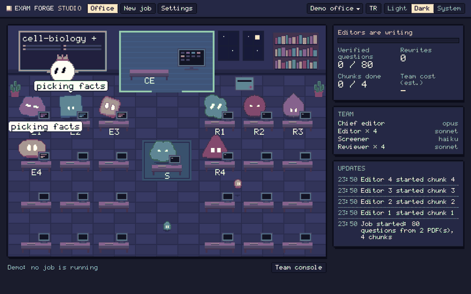
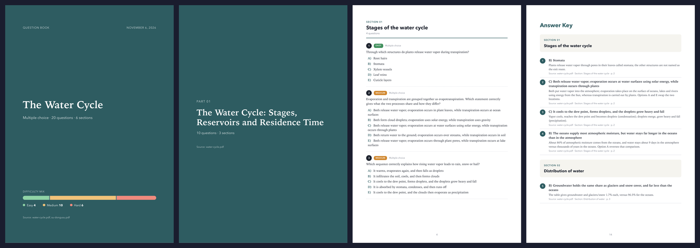
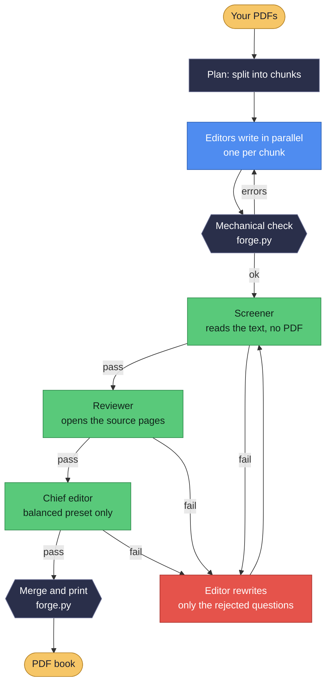
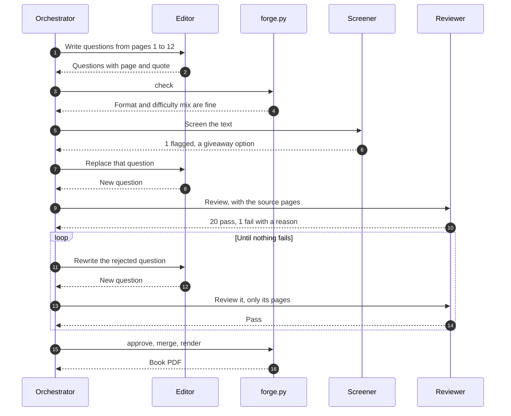
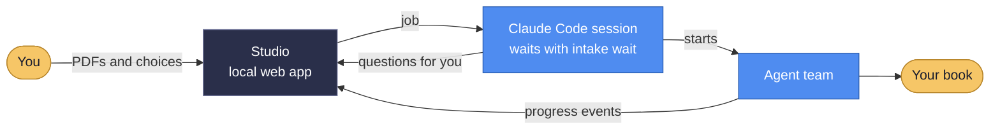
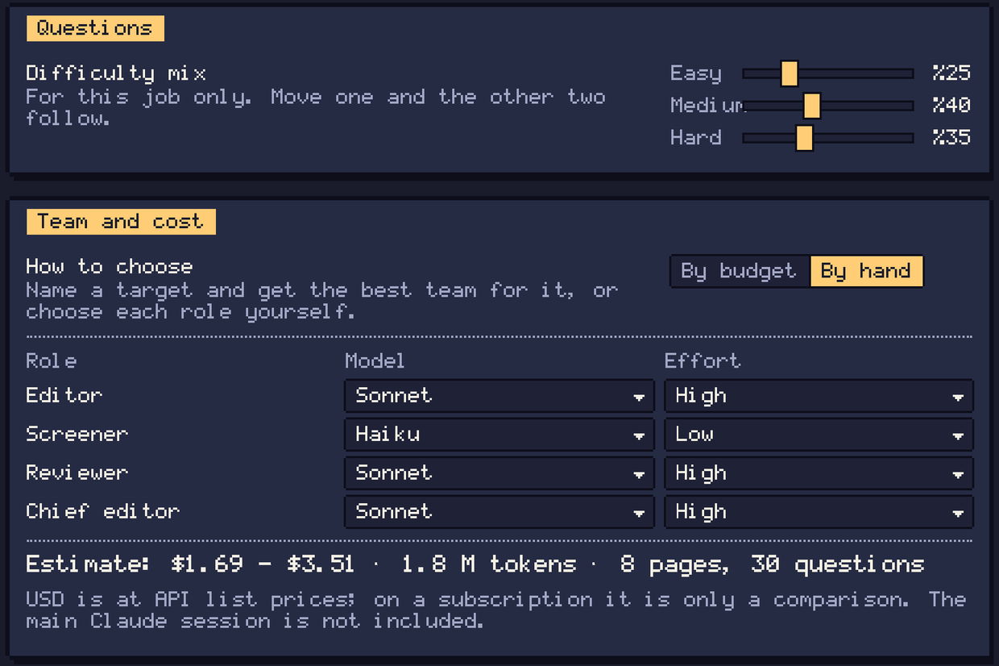
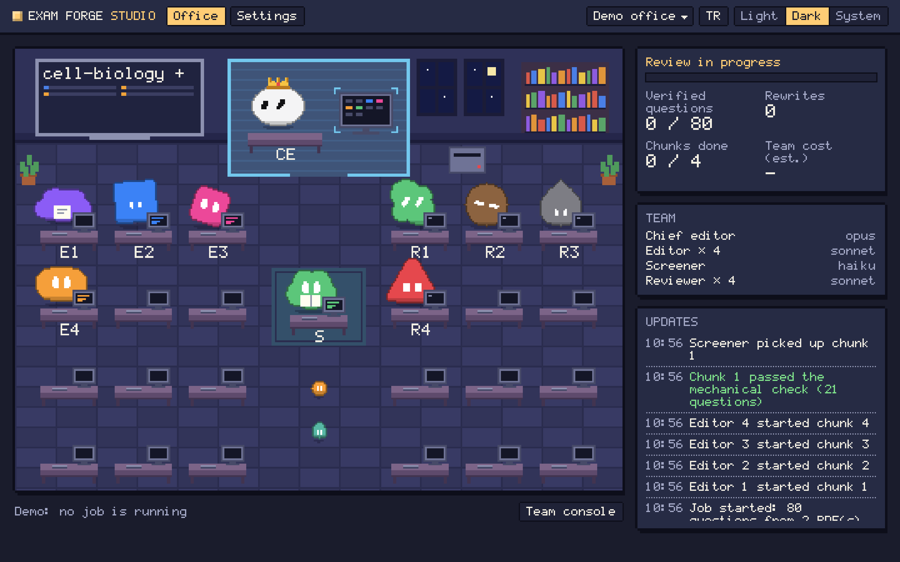

<p align="center">
  
</p>

<h1 align="center">Exam Forge</h1>

<p align="center">
  <strong>Turn lecture notes into a printable question book.<br>
  Every question comes from your source, and an independent review has to pass it.</strong>
</p>

<p align="center">
  <a href="https://github.com/on-retryx/exam-forge/releases/latest"></a>
  <a href="LICENSE"></a>
  
  
</p>

<p align="center">
  <a href="#install">Install</a> ·
  <a href="#use">Use</a> ·
  <a href="#how-it-works">How it works</a> ·
  <a href="#studio">Studio</a> ·
  <a href="examples/water-cycle-questions.pdf">Sample book (PDF)</a> ·
  <a href="#t%C3%BCrk%C3%A7e-%C3%B6zet">Türkçe</a>
</p>

Exam Forge is a [Claude Code](https://claude.com/claude-code) plugin. A team of Claude agents writes, screens, verifies and rewrites questions from your PDFs, and you can watch them work in a small pixel-art office.

<p align="center">
  
</p>
<p align="center"><sub>The Studio's demo run at normal speed.</sub></p>

## Why

AI can write exam questions quickly. The hard part is trusting them. A model can add a fact that was never in your notes, write two correct options, or give the wrong answer key. Exam Forge is built around two rules:

1. **Every question is tied to its source.** Each one carries the page number and a verbatim quote that supports the answer.
2. **Unreviewed questions cannot enter the book.** A separate reviewer opens the PDF pages itself and checks each question. Whatever fails is rewritten. The tool enforces this, so it cannot be skipped.

## What you get

- **Formats:** multiple choice (4 or 5 options) · open-ended · mixed (open + fill-in-the-blank + true/false) · full mix
- **Difficulty:** easy 25%, medium 40%, hard 35% (adjustable)
- **Answers where you want them:** at the end of the book, under each question, or at the end of each section
- **Several PDFs:** one book per PDF, or a single merged book with a cover for each part, named after the file or with a logical title
- **Questions from figures:** a graph, chart, diagram or labelled shape in your PDF can become a question, printed with the cropped figure (needs pymupdf)
- **Any language:** questions follow the language of your PDF. Book labels come in English and Turkish.
- **Handwritten notes:** legible notes in a PDF count as source material, and the answer cites them. Notes that cannot be read with confidence are never guessed at, and a note like "not on the exam" removes that part instead of becoming a question.
- **A live Studio:** a local animated office with the team at their desks, progress, reasons for rejections and estimated cost

### The book

A cover, an optional contents page, a cover for each part, questions grouped by section and an answer key with explanations. These pages come from [`examples/water-cycle-questions.pdf`](examples/water-cycle-questions.pdf), a real output.

<p align="center">
  
</p>

## Install

You need Claude Code, Python 3.9+, and Chrome, Chromium or Edge to print the PDF. Without a browser, the book comes out as HTML that you can print from any browser.

On each run Exam Forge checks these and the PDF page tool, and offers to install what is missing. `forge.py doctor` shows the same list. Nothing is installed without your approval, and pymupdf goes into its own folder, `~/.config/exam-forge/venv`.

In Claude Code:

```
/plugin install exam-forge --marketplace on-retryx/exam-forge
```

Or in two steps:

```
/plugin marketplace add on-retryx/exam-forge
/plugin install exam-forge@retryx
```

## Update

From a terminal:

```
claude plugin marketplace update retryx
claude plugin update exam-forge@retryx
```

Or use the `/plugin` menu in Claude Code. Restart Claude Code afterwards: an update only applies after a restart.

## Use

Drop PDFs into the chat or give their paths, then ask in plain words:

> Make a question book from these two PDFs. The teacher stressed chapter 2.

Or call it directly:

```
/exam-forge:exam-forge ~/Courses/week3.pdf ~/Courses/week4.pdf
```

The Studio opens on a **New job** form. Press **Add** to browse your computer and pick files or whole folders, or drop them onto the form. A folder adds every PDF inside it, and you can remove any you do not want. Then choose the format, where answers should go and, for several PDFs, whether to merge them, then press **Start job**. Everything after that happens in the browser: you watch the team, answer any decision it needs, and open the finished book. PDFs and notes you gave the command are already filled in.

The command works from a terminal too:

```
claude "/exam-forge:exam-forge"
```

Files you add by browsing stay where they are and the book lands next to them. A browser hides the real location of dropped files, so those are copied to `~/Exam Forge/` and the book lands there.

The form needs that Claude Code session to stay open, because the session does the work; the Studio only hands it the job. When a job ends, the session waits for the next one, so you can keep going from the form. To answer in the chat instead, set `studio_job_form` to `false`.

The book lands next to your PDF as `<name>-questions.pdf`.

Try it with [`examples/water-cycle.pdf`](examples/water-cycle.pdf). [`examples/water-cycle-questions.pdf`](examples/water-cycle-questions.pdf) is a real output: one merged book from that note and its Turkish twin, 20 questions, with 7 of them rewritten after review.

## How it works

Your Claude session is the orchestrator. It never writes or reviews a question. It splits the PDFs into chunks, starts one editor per chunk in parallel, and moves each chunk through the checks as soon as it is ready.

### Meet the team

| | Role | Default model | Job |
|---|---|---|---|
|  | **Editor** | Sonnet | Reads only its pages and writes the questions |
|  | **Screener** | Haiku | Catches defects visible in the text, before any costly review. Never opens the PDF. |
|  | **Reviewer** | Opus | Opens the pages and proves each question against the source. Only this step can verify a question. |
|  | **Chief editor** | Opus, `balanced` only | Re-checks hard and rewritten questions plus a sample of the rest |
| | Orchestrator | your session | Splits the work, runs the team, manages the queue |
| | `forge.py` | no model | Plan, mechanical checks, approvals, merging, printing. Python standard library only. |

### From PDF to book



The rule is enforced by the tool, not by goodwill: `forge.py` only merges questions that carry a passing review, so an unverified question cannot reach the book.

### One chunk, step by step

Chunks do not wait for each other. A rejected question costs little, because a rewrite goes back with only the pages it needs.



After `topic_change_round` rounds the editor moves to a different topic in the same pages. After `max_rounds` you decide: drop the question or keep trying.

### Studio and your session

The Studio never runs agents. It hands your job to the Claude Code session, and shows what the session reports. That is why the session has to stay open.



## Cost and quality

The main cost is reopening PDF pages, not writing. Two savings are always on and do not touch quality: the Haiku screener catches text-level defects before the expensive review, and correction rounds reopen only the pages of the rejected questions.

Beyond that, you choose a team preset:

| Preset | Reviewer | Chief editor | Use it when |
|---|---|---|---|
| `quality` (default) | Opus | none | The book matters most |
| `balanced` | Sonnet | Opus on a sample | You want lower cost with a final check |
| `economy` | Sonnet | none | Your plan limit is tight |

Haiku never writes questions and never verifies them. If it misses something, the reviewer still sees every question.

**What we measured.** `evals/run.py` gives each team the same 18 questions on a 4-page note, with 10 planted defects (outside knowledge, two correct answers, wrong keys, a fake quote, a wrong difficulty, a giveaway option, references to the source). Two trials per preset:

| Preset | Defects caught | Screener alone | Cost per trial |
|---|---|---|---|
| `quality` | 10 of 10 | 7 to 8 | about $0.41 |
| `balanced` | 10 of 10 | 7 to 9 | about $0.43 |
| `economy` | 10 of 10 | 6 to 7 | about $0.28 |

All three also failed 3 control questions that we had labeled too hard, so those were our mistakes, not false alarms. The screener wrongly flagged one clean question once. This is a small test on one short note, so treat it as an observation, not proof. On it, the Sonnet reviewer matched Opus, and `balanced` saved nothing. `quality` stays the default until a larger test says otherwise.

**A full job costs more than a review.** A merged book from two 4-page notes (20 questions, 7 rewritten) came to $9.93 at API prices. The team was $4.14 (reviewer $2.71, editors $1.39, screener $0.04); the rest was the Opus orchestrator, inflated by long API delays during that run. Short notes run out of distinct facts, which also adds rewrite rounds.

Long PDFs can use a real share of a Claude Pro session. `/exam-forge:exam-forge` reports the team's cost at the end. Run the comparison yourself with `python3 evals/run.py`, which spends real tokens.

## Studio

The Studio opens in a window of its own when a job starts, with a start screen that checks your setup. Without a Chromium browser it opens as a tab (`studio_window` = `false` does the same). On a Mac it is a small Exam Forge app in `~/Applications` with its own pixel-art icon in the Dock. Keep it in the Dock to open the Studio with a click. It is a pixel-art office drawn entirely in code, including its own font, with no image files, downloads or external services, and it runs only on your computer.

- The team grows with the job: hopping pixel bots in different shapes for each editor and reviewer, a screener, and a crowned chief editor in a glass office, all at desks with their own PCs
- Bots carry pages between desks, PASS and FAIL stamps appear, and speech bubbles show what each bot is doing (`studio_speech_bubbles` turns them off)
- Click the chief editor's computer, or any bot, to open the team console: every agent, its current task, model and recent activity. Move through agents with the arrow keys, or show one in the office.
- Live progress, reasons for rejection, estimated cost, past jobs and every setting
- English and Turkish, day and night themes. With no job running, it plays a demo.

In the job form you can name a cost target in USD or tokens and get the best team for it, or pick each role's model and effort and watch the estimate change. The estimate is a range: it starts from one measured job and adjusts to your own jobs over time. A target is not a hard limit, because the number of rewrite rounds can't be known in advance; if spending passes 120% of it, the Studio asks whether to go on. USD figures use API list prices, so on a subscription they are only a comparison.

It never shows question text. Open it any time with `/exam-forge:studio`. To stop it opening by itself: `studio_auto_open` = `false`. A running Studio closes itself after 30 quiet minutes, and within about a minute and a half if a newer one has replaced it, but not while a window is open, a question is waiting for an answer, or a job has written an event in the last 15 minutes. One agent that stays silent for longer, with no window open, can see it close. `ask` starts it again when it needs one.

### A look around

| Pick the difficulty mix, the team and a cost target | Watch the job in the office |
|---|---|
|  |  |

## Settings

Change settings in the Studio, in plain words with `/exam-forge:config`, or from the helper:

```
/exam-forge:config set answer_placement inline
/exam-forge:config set quality_preset balanced
```

They are stored in `~/.config/exam-forge/settings.json`.

| Key | Default | Meaning |
|---|---|---|
| `answer_placement` | `book_end` | `book_end`, `inline` or `section_end` |
| `merge_books` | `ask` | `ask`, `always` or `never` |
| `section_titles` | `logical` | Part covers: `logical` title or `filename` |
| `book_language` | `auto` | Book labels: `auto`, `en` or `tr` |
| `question_language` | `auto` | `auto` follows the PDF; or a language name |
| `output_dir` | empty | Empty means next to the first PDF |
| `field` | empty | Exam style, such as medicine or law |
| `mcq_options` | 5 | Options per question: 4 or 5 |
| `figure_questions` | true | Editors may write questions from figures, and the book prints them |
| `difficulty_mix` | 0.25 / 0.40 / 0.35 | Easy, medium, hard; sums to 1 |
| `short_pdf_pages` | 20 | Below this, use fixed question counts |
| `short_pdf_question_options` | 10, 15 | Counts the editor can pick on short PDFs |
| `questions_per_page` | 1.0 | For longer PDFs |
| `thin_page_floor` | 0.6 | Lowest share of the target on thin pages |
| `handwritten_notes` | true | Questions may rest on legible handwritten notes. Off, only notes about exam scope apply |
| `quality_preset` | `quality` | `quality`, `balanced` or `economy` |
| `screener_enabled` | true | Haiku first pass |
| `chief_sample_rate` | 0.25 | Share of easy and medium questions the chief editor checks |
| `models.*` | empty | Override a role: `editor`, `screener`, `reviewer`, `chief_editor` |
| `topic_change_round` / `max_rounds` | 4 / 6 | When a stuck question changes topic, and when you are asked |
| `split_threshold` / `chunk_pages` | 25 / 20 | PDFs longer than this split into chunks of this size |
| `studio_auto_open` / `studio_port` | true / 8765 | Studio behavior |
| `studio_job_form` | true | Start jobs from the Studio form instead of the chat |
| `studio_speech_bubbles` | true | Bots show their current task in the Studio |
| `browser` | empty | Browser path for printing (or `EXAM_FORGE_BROWSER`) |
| `pricing` | see file | USD per million tokens, used only for estimates |

## Privacy and copyright

- Exam Forge reads only the files you give it. It does not search the web or use other sources.
- The Studio's file browser runs only on this computer and shows only folders and PDF names. It opens a file only when you add it. Dropped files are copied to `~/Exam Forge/`; delete them whenever you like.
- Your questions stay yours. The run folder sits next to your book, and nothing is copied elsewhere. Your PDFs are processed by Claude as usual in Claude Code.
- Use only material you have the right to use. Questions include short quotes from the source, and books reproduce figures from it, so you need the right to use those figures as well. Turn this off with `figure_questions`.
- The review catches most errors, but it is still AI. Use the book to study. Have a person check it before using it as an official exam.

## Development

```
python3 -m unittest discover -s tests
claude plugin validate .
claude --plugin-dir .
```

New features use a score ratchet, [`tools/ratchet.py`](tools/ratchet.py). Tests come first and must fail. Each step is scored out of 100: 70 for the feature's tests, 30 for all the others. A higher score is pushed, and a lower one is undone back to the best commit. `ratchet.py gate` passes only when every test passes, and it runs before and after each merge.

## License

[MIT](LICENSE) · RetryX

---

## Türkçe özet

**Exam Forge**, ders notu PDF'lerinden yazdırılabilir soru kitabı üreten bir Claude Code eklentisidir. Her soru kaynak sayfa ve birebir alıntı taşır. Ayrı bir reviewer sayfaları kendisi açıp denetler, doğrulanmamış soru kitaba giremez. Sorular PDF'in dilinde yazılır; Türkçe kaynak Türkçe soru verir. Kitap etiketleri ve Studio arayüzü Türkçe de kullanılabilir. PDF'teki grafik, şema ve şekillerden de soru yazılabilir; kitap şekli sorunun yanında basar, bu yüzden o şekilleri kullanma hakkınız olmalıdır (`figure_questions` ile kapatılabilir). Cevaplar kitabın sonuna, sorunun altına ya da bölüm sonuna konabilir. Birden çok PDF tek kitapta birleştirilebilir. El yazısı notlar da kaynak sayılır: okunaklı bir nottan soru çıkabilir ve cevapta bu not gösterilir. Güvenle okunamayan not asla tahmin edilmez; "sınavda yok" gibi notlar ise soru olmaz, o kısmı kapsam dışı bırakır. `handwritten_notes` ayarıyla kapatılabilir. `/exam-forge:exam-forge` Studio'da bir iş formu açar; dosya ya da klasör ekleme (gezinerek veya sürükle bırakla), ayarlar ve işin takibi tarayıcıdan yapılır, Claude Code oturumu ise açık kalır. Tüm ayarlar Studio'dan ya da `/exam-forge:config` ile değişir. Kurulum: `/plugin install exam-forge --marketplace on-retryx/exam-forge`. Güncellemeden sonra Claude Code'u yeniden başlatın; güncelleme ancak o zaman geçerli olur.
